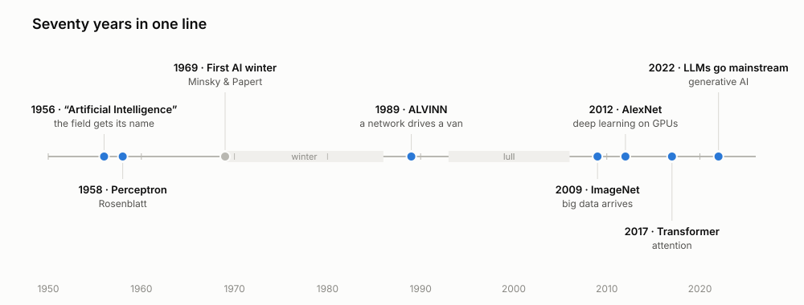
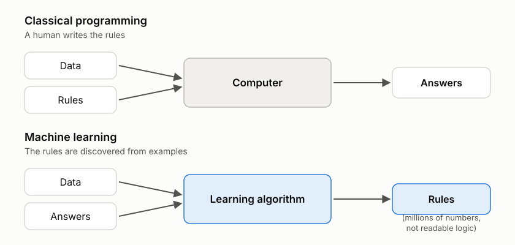
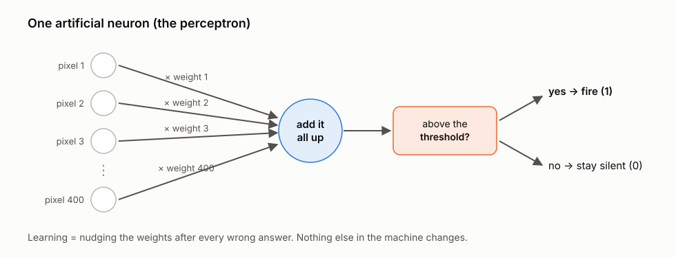
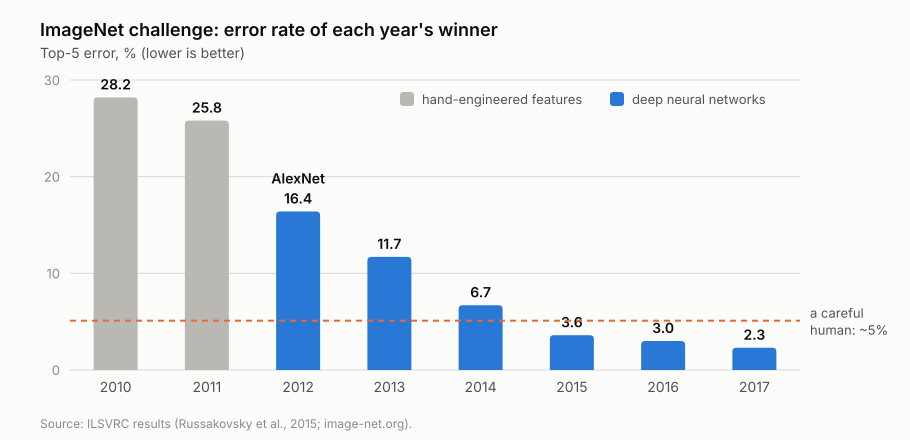
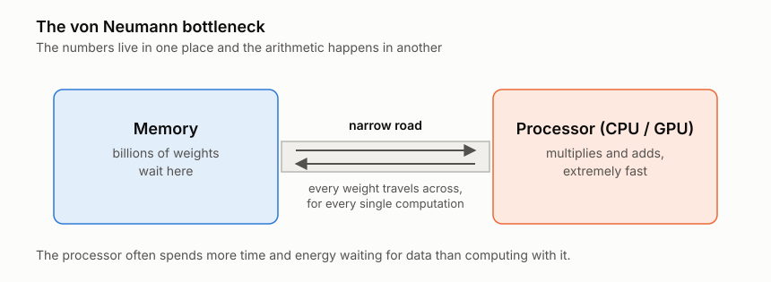
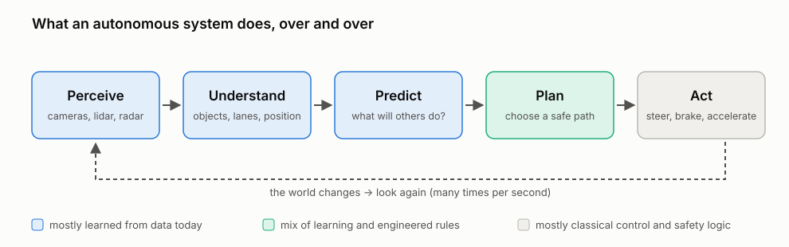

# Artificial Intelligence Fundamentals

## Lecture 1: From hand-written rules to machines that learn

> **What this lecture is about.** Seventy years ago a machine the size of a wardrobe learned to tell circles from rectangles. Today, machines write code, hold conversations and drive cars through city traffic. This lecture tells the story of how we got from one to the other, and why the story is far from over. There are no formulas today. The goal is to understand the *ideas*, the people behind them, and the three ingredients that keep returning: **algorithms, data and computing power**.

**Contents**

1. [Two ways to make a computer do something](#1-two-ways-to-make-a-computer-do-something)
2. [The birth of AI and the Perceptron](#2-the-birth-of-ai-and-the-perceptron)
3. [Neural networks return: a van that learned to steer](#3-neural-networks-return-a-van-that-learned-to-steer)
4. [ImageNet: the missing ingredient was data](#4-imagenet-the-missing-ingredient-was-data)
5. [From one GPU to entire datacenters](#5-from-one-gpu-to-entire-datacenters)
6. [From deep learning to generative AI and LLMs](#6-from-deep-learning-to-generative-ai-and-llms)
7. [The new computing crisis](#7-the-new-computing-crisis)
8. [AI becomes an infrastructure problem](#8-ai-becomes-an-infrastructure-problem)
9. [The future of AI computing](#9-the-future-of-ai-computing)
10. [AI in autonomous robots and vehicles](#10-ai-in-autonomous-robots-and-vehicles)
11. [Questions](#11-questions)

---

## 1. Two ways to make a computer do something

Strip away the details and most software does two things: it **moves data** and it **processes data**. Moving data is plumbing. Processing data is where the interesting decisions are made, and there are two fundamentally different ways to build the part that makes them.

### Writing the rules by hand

In classical programming a human thinks hard about the problem and writes down the rules explicitly. The computer applies those rules to the data and produces answers.

*Example:* "If the pixel brightness along this line is above a threshold, mark it as a lane marking."

This works beautifully when we understand the problem well enough to state the logic. It is also transparent: when the program makes a mistake, we can read the rule that caused it and fix it.

### Letting the machine find the rules

In machine learning we turn the arrangement around. We give the computer example inputs **together with the answers we want**, and an algorithm searches for the rules that connect them.

Two things are worth noticing:

- The learned "rules" are not sentences a person can read. They are **parameters**: numbers, often millions or billions of them, that together determine what the program does.
- Nobody typed those numbers in. They were adjusted, step by step, until the program's answers matched the examples.

*Example:* In 1989 a system called ALVINN learned to steer a van by watching a human drive. Nobody wrote a single lane-following rule for it. We will meet ALVINN properly in Section 3.

### When should we use which?

| | Hand-written rules | Learning from data |
|---|---|---|
| **Works well when** | the problem is well understood and the logic can be stated | the rules are too complex to write down, but examples are plentiful |
| **Typical example** | computing a braking distance from speed | recognising a pedestrian in a camera image |
| **Strength** | transparent, predictable, can come with guarantees | handles messy, real-world variety |
| **Weakness** | breaks down when the world is too varied to enumerate | needs lots of data, and is harder to inspect |

Try to write down the rules for "this image contains a pedestrian". People can be near or far, facing any direction, partly hidden behind a car, carrying an umbrella, in sunlight or at night. Every rule you write has an exception. That is the kind of problem where learning wins.

In practice the choice is a **spectrum, not a switch**. A learning system still depends on human design decisions: which model to use, what to measure as "error", which data to collect. And most real systems, including autonomous vehicles (Section 10), combine both approaches.

### So what is machine learning?

A working definition for this course:

> **Machine learning** is any algorithm that discovers a set of parameters consistent with the statistics of its training data.

The important word hides in what comes next. The goal is not to memorise the training examples. The goal is to **generalise**: to give good answers on *new* data that the system has never seen, as long as it resembles what it was trained on. A student who memorises last year's exam has fitted the data. A student who can solve this year's exam has generalised.

Models can capture patterns at very different levels, from a simple straight-line relationship to deep neural networks that build up a hierarchy of increasingly abstract features (edges, then shapes, then objects).

> **Pause and think.** Pick an app you used today. Which parts of it are probably hand-written rules, and which parts are probably learned?

---

## 2. The birth of AI and the Perceptron

The term **"Artificial Intelligence"** was coined in the mid-1950s for a summer workshop held at Dartmouth College in 1956. A small group of researchers believed that every aspect of intelligence could, in principle, be described precisely enough for a machine to simulate it. The optimism of that summer set the tone for the decades that followed.

### A machine modelled on the brain

In 1958 Frank Rosenblatt, a psychologist at Cornell, presented the **Perceptron**. His starting point was biology.

A real neuron is a small decision-maker. It receives signals from many other neurons. Some connections encourage it to fire (excitatory), others discourage it (inhibitory). If the combined input is strong enough to cross a threshold, the neuron fires. Otherwise it stays silent. All or nothing: 1 or 0.

Rosenblatt built this idea into hardware:

- **The eye:** a 20 × 20 grid of 400 light sensors (photocells), each acting as one pixel.
- **The connections:** every pixel was wired to an output neuron through an adjustable **weight**. A positive weight means "this pixel is evidence *for*", a negative weight means "evidence *against*".
- **The decision:** multiply each pixel's value by its weight, add everything up, and check whether the total crosses the threshold.

That "multiply and add up" step has a name in mathematics, the *dot product*. Remember it. Seventy years later it is still the operation that AI hardware spends almost all of its time on.

### How it learned

The learning rule is simple enough to say in one breath: **show an example; if the machine gets it wrong, nudge the weights in the direction that would have made it right; repeat.**

After enough examples the weights settle, and the machine can separate, for example, circles from rectangles. Nobody told it what a circle is. It found weights that work.

<!-- Photo: Frank Rosenblatt with the Mark I Perceptron (U.S. Navy photo, public domain, via Wikimedia Commons) -->

*Frank Rosenblatt with the Mark I Perceptron. Photo: U.S. Navy, public domain, via Wikimedia Commons.*

### Hype, and the first AI winter

The Perceptron could classify simple shapes and letters. The claims made about it went much further. Rosenblatt suggested it would soon tell cats from dogs and show something like original thought, and in 1958 *The New York Times* reported the Navy's expectation that such a machine would one day walk, talk, see and be conscious of its own existence.

Reality caught up in 1969. Marvin Minsky and Seymour Papert at MIT published *Perceptrons*, a careful mathematical analysis showing that a single layer of these neurons has strict limits: there are simple patterns it can never learn, no matter how long it trains. The book is widely credited with helping to drain funding and interest from the field. This period became known as the first **"AI winter"**.

It is a pattern worth remembering, because it repeats: a real result, inflated promises, disappointment, retreat.

The first three chapters of this lecture follow the first half of this video, which is an excellent companion:

<iframe width="720" height="405" src="https://www.youtube.com/embed/GVsUOuSjvcg" title="Future Computers Will Be Radically Different (Analog Computing) - Veritasium" frameborder="0" allow="accelerometer; clipboard-write; encrypted-media; gyroscope; picture-in-picture" allowfullscreen></iframe>

*Video: [Future Computers Will Be Radically Different (Analog Computing)](https://www.youtube.com/watch?v=GVsUOuSjvcg), Veritasium, 2022.*

---

## 3. Neural networks return: a van that learned to steer

The limits Minsky and Papert described applied to a *single* layer. What if we stack several?

### Hidden layers

In the 1980s researchers showed how to train networks with an intermediate **hidden layer** between input and output. The hidden neurons are free to become detectors for whatever intermediate patterns turn out to be useful. The training method that made this practical is called **backpropagation**: after each mistake, the error is passed backwards through the network so that every weight learns how much it contributed and in which direction it should change.

### ALVINN

The most memorable demonstration came from Carnegie Mellon University: **ALVINN**, the *Autonomous Land Vehicle in a Neural Network*, built by Dean Pomerleau around 1989.

- **Input:** a tiny 30 × 32 pixel image of the road ahead, 960 numbers.
- **Hidden layer:** just 4 neurons.
- **Output:** 30 neurons, each standing for a steering direction from "sharp left" to "sharp right". The most active one wins.

To train it, a person simply drove. The network watched the camera image and the steering wheel, and backpropagation adjusted the weights until the network's steering matched the human's. After a few minutes of driving, ALVINN could take over. When researchers later looked at the weights of the hidden neurons, they could see what the network had taught itself to look for: road edges and lane markings.

Getting from one layer to the next means multiplying a whole table of weights by a whole list of activations. This is **matrix multiplication**, which is simply the perceptron's "multiply and add up" done many times at once.

<!-- IMAGE SLOT: CMU Navlab / ALVINN vehicle photo, or a frame of the ALVINN weight visualisation from the Veritasium video (around the ALVINN segment) -->

### The second lull

ALVINN worked, and it exposed the next obstacle. Its first versions crawled along at walking pace, because the computers of the day needed most of a second to push one image through the network. (With faster hardware, later versions reached highway speeds on real roads in the early 1990s, a remarkable result for a network with four hidden neurons.)

More broadly, neural networks still could not handle everyday vision. Telling a cat from a dog remained out of reach. Through the 1990s and early 2000s the field went quiet again, and researchers argued about the cause. Were the algorithms wrong? Or were the computers simply too slow?

As it turned out, a third possibility had been overlooked.

*Optional viewing for the curious, a visual explanation of what layers and weights do:*

<iframe width="720" height="405" src="https://www.youtube.com/embed/aircAruvnKk" title="But what is a neural network? - 3Blue1Brown" frameborder="0" allow="accelerometer; clipboard-write; encrypted-media; gyroscope; picture-in-picture" allowfullscreen></iframe>

*Video: [But what is a neural network?](https://www.youtube.com/watch?v=aircAruvnKk), 3Blue1Brown.*

---

## 4. ImageNet: the missing ingredient was data

### A different diagnosis

In the mid-2000s **Fei-Fei Li** proposed that the theory behind neural networks was not the problem. The networks were starving. A child sees millions of images in their first years of life; the networks of the time were trained on a few thousand.

So she set out to build the dataset that did not exist. Between roughly 2006 and 2009 her team assembled **ImageNet**: millions of photographs collected from the internet, each labelled by people. The full collection grew to about 14 million images. The best-known part of it, used for the annual competition, contains about **1.2 million training images in 1,000 object categories**.

<iframe width="720" height="405" src="https://www.youtube.com/embed/40riCqvRoMs" title="How we teach computers to understand pictures - Fei-Fei Li, TED" frameborder="0" allow="accelerometer; clipboard-write; encrypted-media; gyroscope; picture-in-picture" allowfullscreen></iframe>

*Video: [How we teach computers to understand pictures](https://www.youtube.com/watch?v=40riCqvRoMs), Fei-Fei Li, TED.*

### The competition

From 2010 to 2017 research groups competed every year on ImageNet. The score was the **top-5 error rate**: the model may make five guesses for each image, and it counts as an error only if the correct label is not among them.

In 2010 and 2011 the winners used carefully hand-engineered image features and landed at about 28% and 26% error. Progress was slow and incremental.

Then, in 2012, a team from the University of Toronto (Alex Krizhevsky, Ilya Sutskever and Geoffrey Hinton) entered a neural network now known as **AlexNet**. It scored 16.4%. In a competition where a one-point improvement was a good year, it won by almost ten.

### Why AlexNet succeeded

Three things came together:

- **A bigger, deeper network.** 8 learned layers and about 60 million parameters. Compare that with ALVINN's 4 hidden neurons.
- **Enough data.** Over a million labelled examples from ImageNet.
- **A new kind of computer.** AlexNet was trained on two NVIDIA GTX 580 graphics cards: hardware designed for video games. A GPU performs huge numbers of simple multiply-and-add operations in parallel, which is exactly what a neural network needs.

Within three years, much deeper networks had pushed the error rate below that of a careful human on the same task.

The lesson that the field took away shaped everything that followed: **neural networks improve dramatically when algorithms, data and computing power are scaled up together.** None of the three is enough alone.

---

## 5. From one GPU to entire datacenters

### Why GPUs?

A **CPU** is a generalist. It is built to handle complicated, varied tasks one after another, very quickly. A **GPU** is a specialist. It was designed to compute the colour of millions of pixels at once, so it performs an enormous number of *similar, simple* calculations in parallel.

A useful picture: a CPU is a handful of brilliant mathematicians; a GPU is a stadium full of people who can each do one multiplication. For the matrix multiplications inside a neural network, the stadium wins easily.

This is how a product built for gaming became one of the key enabling technologies of modern AI. Later, chips designed specifically for neural networks appeared as well, such as Google's TPUs.

### Beyond a single machine

AlexNet needed two graphics cards. As models and datasets kept growing, one machine was no longer enough, and training spread across many GPUs, then many servers, then whole buildings. There are three basic ways to share the work:

- **Data parallelism:** every GPU holds a copy of the model and works through a different portion of the training examples.
- **Model parallelism:** the model is too big for one GPU, so different parts of it live on different GPUs.
- **Pipeline parallelism:** the layers are arranged like an assembly line, with each device handling one stage and passing its result to the next.

Once thousands of chips have to cooperate, the connections *between* them matter almost as much as the chips themselves. A fast processor that waits for its neighbour is a slow processor.

<!-- IMAGE SLOT: photo of a GPU next to a datacenter aisle / GPU rack, to show the jump in scale -->

### The convergence

By the late 2010s, three ingredients had reached a scale nobody had seen before:

- **Data:** the internet had produced an ocean of digital text, images and video.
- **Compute:** GPU clusters and datacenters could train ever larger models.
- **Architecture:** new network designs could make efficient use of both.

That third ingredient is the subject of the next section.

---

## 6. From deep learning to generative AI and LLMs

### The scaling era

After 2012 the recipe was clear, and researchers followed it with enthusiasm: more parameters, more data, more compute. Networks grew from tens of millions of parameters to billions, and then to hundreds of billions.

### The Transformer

In 2017 a new architecture called the **Transformer** arrived. Its central idea is **attention**: when the model processes one element of a sequence, such as a word in a sentence, it can look at all the other elements and decide which ones matter for understanding this one. In "The trophy did not fit in the suitcase because **it** was too big", attention is what lets a model connect "it" to "trophy".

Just as important is a practical property. Earlier language models read text one word at a time, in order, which is hard to speed up. A Transformer processes the whole sequence at once, so the work can be split across many GPUs. It was an architecture built for the datacenter era, able to absorb as much data and compute as anyone could supply.

### Predicting the next word

Researchers then tried something simple and ambitious. Rather than training one model for translation, another for summarising and another for answering questions, they trained one very large Transformer on an enormous collection of text with a single objective:

> **Predict the next token.** (A token is a word or a piece of a word.)

"The capital of France is ___". To be reliably good at filling in blanks like this across billions of sentences, a model has to pick up grammar, facts, the style of different kinds of writing, and some of the relationships between concepts. Nobody programs these in. They emerge as the statistical structure the model needs in order to predict well.

These models are called **generative** because they produce new content, where earlier systems mostly classified or analysed existing data. **Large Language Models (LLMs)** generate text and code. The same approach was developed for images, audio and video, and **multimodal** models now combine several of these in one system.

Seen from a distance, this is the lesson of AlexNet again, at a thousand times the scale: a scalable architecture, internet-sized data and datacenter-sized compute.

<iframe width="720" height="405" src="https://www.youtube.com/embed/wjZofJX0v4M" title="Transformers, the tech behind LLMs - 3Blue1Brown" frameborder="0" allow="accelerometer; clipboard-write; encrypted-media; gyroscope; picture-in-picture" allowfullscreen></iframe>

*Video: [Transformers, the tech behind LLMs](https://www.youtube.com/watch?v=wjZofJX0v4M), 3Blue1Brown. The first few minutes give the intuition; the rest goes deeper than we need today.*

> **Pause and think.** An LLM is trained only to predict the next token. Why might that single task force it to learn so much about the world?

---

## 7. The new computing crisis

For a decade, the way to get better AI has been to scale everything up. But a model is not an abstract idea floating in the cloud. It runs on physical machines, and physical machines have limits.

### Compute

Training a state-of-the-art model can occupy thousands of accelerators for weeks or months. And training is only the beginning. Once a model is released, answering the questions of millions of users (called **inference**) creates a workload that never stops.

### Memory

Every parameter has to be stored somewhere. A quick estimate: one parameter typically takes about 2 bytes, so a model with 1 billion parameters needs about 2 gigabytes. A model with 100 billion parameters needs about 200 gigabytes, just to hold the weights.

Training needs considerably more, because the system also has to keep the intermediate results and the bookkeeping required to update each weight. This is why modern AI creates heavy demand for GPUs and also for a special kind of fast memory placed right next to them, called **high-bandwidth memory (HBM)**.

### The memory wall

Here is a subtle and important problem. Processors have become extremely fast at arithmetic. *Moving* numbers between memory and the processor has not improved at the same pace.

Almost every computer since the 1940s follows the same basic plan: data is kept in one place (memory) and calculated on in another (the processor). For a neural network, this means that huge tables of weights are constantly shuttled back and forth. More and more, the processor spends its time and energy waiting for data to arrive. This is known as the **von Neumann bottleneck**.

Think of a superb chef in a kitchen where every ingredient has to be fetched from a storeroom at the end of a long corridor. Hiring a faster chef does not help.

### Power and heat

Nearly all the electrical energy a computer consumes ends up as heat. A rack of AI servers can draw as much power as dozens of households, and all of it has to be removed again by cooling systems. The design of a modern datacenter is therefore governed by questions that have little to do with software: Is there enough electricity here? Can the grid deliver it? How do we get the heat out?

### The end of free improvement

For fifty years, the industry could count on **Moore's Law**: transistors kept shrinking, so every couple of years the same money bought roughly twice the computing power. That trend is running into physical limits. Transistors are now only a few dozen atoms across, and each further step is harder and more expensive than the last.

So the demand for computation is rising faster than ever at exactly the moment when the traditional source of cheap computation is slowing down. That is the crisis in the title.

---

## 8. AI becomes an infrastructure problem

Put the previous section together and a surprising conclusion follows: progress in AI now depends heavily on **physical infrastructure**. Building AI capacity means building, or securing access to:

- semiconductor fabrication plants,
- GPUs and other accelerators,
- high-bandwidth memory,
- networking equipment,
- datacenter buildings,
- electricity generation and distribution,
- cooling systems.

**Supply and demand.** AI companies and cloud providers compete for a limited supply of advanced chips. That demand spreads down the supply chain to memory and other components, and it can affect the availability and price of ordinary computer hardware too.

**Datacenter expansion.** Technology companies are investing enormous sums in new datacenters, and they are choosing locations based on access to large amounts of electricity, fast network connections and cooling.

The consequence is that AI is no longer only a topic for computer scientists. It touches energy policy, manufacturing, construction and international trade. As engineers, whatever your specialisation, you are likely to meet it from one of these directions.

---

## 9. The future of AI computing

### Can we keep scaling?

Three facts from the last sections point in the same direction:

- Smaller transistors are increasingly difficult and expensive to make.
- A large share of the energy in today's AI systems goes into moving data, not computing with it.
- The scale of datacenters is already constrained by power and cooling.

When the usual path gets steep, it is worth asking whether there are other paths. Researchers are exploring several:

| Direction | The idea in one sentence |
|---|---|
| **More specialised digital chips** | Design the processor for neural networks only, and remove everything else. |
| **Lower-precision computation** | A network rarely needs sixteen decimal places; use small, cheap numbers instead. |
| **Processing-in-memory** | Do the arithmetic where the data is stored, so it never has to travel. |
| **Neuromorphic computing** | Build chips that work more like biological neurons, active only when something happens. |
| **Optical computing** | Compute with light instead of electric current. |
| **Analog computing** | Let physics do the multiplication directly. |

### Analog matrix multiplication

The last idea closes a circle in our story, so let us look at it more closely.

A digital computer represents every number as a pattern of ones and zeros, and multiplying two numbers takes thousands of transistors switching in sequence. An analog circuit takes a shortcut. If a **voltage** represents one number and the **conductance** of a component represents another, then the **current** that flows is their product. Physics performs the multiplication for free. Connect many such components to one wire and the currents add up by themselves.

Multiply, then add up. That is the perceptron's operation, and it is exactly what a neural network needs billions of times per second. An array of analog devices can, in principle, carry out an entire matrix multiplication in a single step, using a small fraction of the energy.

The attraction is **enormous potential efficiency**. The price is everything that made the world go digital in the first place: analog signals are noisy, never perfectly accurate, harder to program and harder to manufacture consistently. Whether the tolerance of neural networks for small errors is enough to make this practical is an open and active question. The second half of the Veritasium video from Section 2 shows one company's attempt.

It is a pleasing thought to end the computing story on: Rosenblatt's Perceptron of 1958 was itself an analog machine.

---

## 10. AI in autonomous robots and vehicles

Everything so far has happened inside computers. The most demanding test of AI is to let it act in the physical world, where mistakes have consequences. Autonomous driving is the best-known example, and its history mirrors the whole lecture: it begins with hand-engineered rules and moves steadily towards learning from data.

### From research prototypes to a field

Early autonomous driving research relied mostly on classical robotics, computer vision and carefully engineered rules. ALVINN (Section 3) was the exception that showed a neural network could learn driving behaviour directly from data, twenty years before the hardware was ready to exploit the idea.

The event that turned scattered research projects into a field was a series of competitions organised by the US research agency DARPA:

- **2004, Grand Challenge:** drive about 230 km through the desert with no human on board. The best vehicle managed less than 12 km. Nobody finished.
- **2005, Grand Challenge:** only a year and a half later, five vehicles completed the 212 km (132 mile) course. Stanford's **Stanley** finished first, in just under seven hours.
- **2007, Urban Challenge:** the vehicles had to drive in a mock city among other traffic: obeying traffic rules, merging, parking and negotiating intersections.

<iframe width="720" height="405" src="https://www.youtube.com/embed/Natbh3t6mHM" title="DARPA Grand Challenge 2005 - Stanley" frameborder="0" allow="accelerometer; clipboard-write; encrypted-media; gyroscope; picture-in-picture" allowfullscreen></iframe>

*Video: [DARPA Grand Challenge 2005, Stanley](https://www.youtube.com/watch?v=Natbh3t6mHM), condensed footage of the winning run.*

### The move to industry

Many of the engineers from those desert races went on to found the industry. In **2009** Google started its **Self-Driving Car Project**, which became **Waymo** in 2016. The goal was fully autonomous driving on public roads, and through the 2010s the combination of better sensors, more computing power and deep learning made steadily more complex driving possible.

<iframe width="720" height="405" src="https://www.youtube.com/embed/B8R148hFxPw" title="Waymo 360° Experience: A Fully Autonomous Driving Journey" frameborder="0" allow="accelerometer; clipboard-write; encrypted-media; gyroscope; picture-in-picture" allowfullscreen></iframe>

*Video: [Waymo 360° Experience: A Fully Autonomous Driving Journey](https://www.youtube.com/watch?v=B8R148hFxPw), Waymo. Drag the picture to look around, and watch what the vehicle "sees".*

### Tesla and learning from a fleet

Tesla took a different route. It did not treat autonomy as a problem for a small number of specially equipped research vehicles. It put cameras and computers into mass-produced consumer cars and used the data from that fleet to develop its driver-assistance and self-driving software.

Whatever one thinks of the competing strategies, this highlighted an important shift in modern AI:

> **A large deployed system continuously generates real-world data, and that data can be used to improve the next version of the system.**

This is Fei-Fei Li's insight about data, turned into an engine that keeps running.

### What does AI actually do in an autonomous system?

<!-- IMAGE / VIDEO SLOT ("SHOW IMAGES AND VIDEOS HERE"): perception output examples - object detection boxes, lane and drivable-space segmentation, depth estimation, trajectory prediction -->

An autonomous system runs the same loop many times per second. AI can contribute to each stage:

- **Perceive** the environment through cameras, lidar and radar.
- **Recognise** what is there: vehicles, pedestrians, traffic signs, lanes and drivable space.
- **Estimate** its own state and the 3D structure of its surroundings, including depth.
- **Predict** how the scene will change: will that pedestrian step into the road?
- **Select actions or plans** based on all of the above.

Modern systems do **not** hand everything over to a neural network. They combine AI with classical robotics, control theory and dedicated safety mechanisms. Remember Section 1: rules where we need transparency and guarantees, learning where the world is too varied to enumerate.

### Beyond cars

The same ideas appear across many kinds of machine:

- mobile robots in warehouses and factories,
- delivery robots,
- drones and other unmanned aerial vehicles,
- agricultural and construction machines,
- service robots,
- autonomous road vehicles.

The hardware and the environments differ enormously. The underlying questions are the same: *Where am I? What is around me? What will happen next? What should I do?*

### The shift toward data-driven autonomy

Over time, more and more of the loop above has moved from manually engineered rules to models learned from large datasets. Deep learning took over perception first. Learning-based methods are now increasingly used for prediction, planning and decision-making as well.

The whole evolution, for robots and vehicles alike, fits on one line:

> **hand-engineered rules → machine learning → deep learning → large-scale data-driven autonomy**

### Where things are heading

- **End-to-end learning.** One large network maps sensor input directly to driving decisions. This is ALVINN's idea from 1989, returning with vastly more data and compute.
- **Multimodal models** that combine camera images, other sensors, maps and language in a single system.
- **Agentic AI.** An emerging direction in which an AI system reasons about goals, uses tools and sensor information, plans multi-step actions and coordinates with the other components of the machine. This could enable more capable high-level behaviour, while conventional planning, control and safety mechanisms keep authority over safety-critical, low-level actions.

A note of realism to finish: systems deployed today still largely combine AI with conventional software, safety mechanisms and classical low-level control. Remember the Perceptron headlines of 1958. Being excited about a technology and being precise about what it can currently do are both part of an engineer's job.

---

## 11. Questions

1. Why can a system that fits its training data perfectly still fail in the real world?
2. The Perceptron, ALVINN and AlexNet each lacked, or finally had, a different ingredient. Which one in each case?
3. Why did a chip designed for video games become central to AI?
4. If you were building an autonomous delivery robot, which parts would you want to be learned, and which parts would you insist on writing as explicit rules? Why?

---

### Sources and further viewing

- Veritasium, [Future Computers Will Be Radically Different (Analog Computing)](https://www.youtube.com/watch?v=GVsUOuSjvcg), 2022.
- F. Rosenblatt, "The Perceptron: A Probabilistic Model for Information Storage and Organization in the Brain", *Psychological Review*, 1958.
- M. Minsky and S. Papert, *Perceptrons*, MIT Press, 1969.
- D. Pomerleau, [ALVINN: An Autonomous Land Vehicle in a Neural Network](https://proceedings.neurips.cc/paper/1988/hash/812b4ba287f5ee0bc9d43bbf5bbe87fb-Abstract.html), NIPS, 1989, and [Efficient Training of Artificial Neural Networks for Autonomous Navigation](https://courses.cs.washington.edu/courses/cse481c/11au/papers/Pomerleau.pdf), 1991.
- A. Krizhevsky, I. Sutskever and G. Hinton, "ImageNet Classification with Deep Convolutional Neural Networks", NIPS, 2012.
- O. Russakovsky et al., "ImageNet Large Scale Visual Recognition Challenge", *IJCV*, 2015.
- A. Vaswani et al., "Attention Is All You Need", NIPS, 2017.
- Stanford Racing Team, [Stanley](https://cs.stanford.edu/group/roadrunner/stanley.html).
- 3Blue1Brown, [Neural networks](https://www.youtube.com/watch?v=aircAruvnKk) and [Transformers](https://www.youtube.com/watch?v=wjZofJX0v4M).
