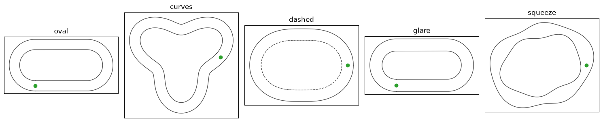
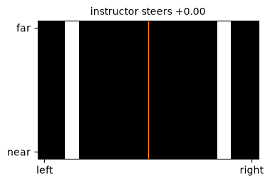
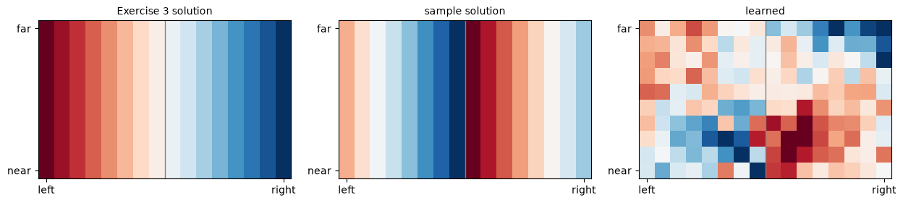

# Lane Following Lab: Rules vs. Learning

In the [lecture](README.md#1-two-ways-to-make-a-computer-do-something) you saw two ways to make a computer process data: **write the rules by hand**, or **give an algorithm examples and let it find the rules**. In this lab you do both on the same problem and compare them.

A small robot drives along a lane. It has a tiny black-and-white camera and controls only its steering. Your job is to turn the camera image into a steering command.

!!! abstract "The one idea of this lab"
    Both drivers you build are the **same machine**:

    $$\text{steering} = \sum_{\text{pixels}} \text{pixel} \times \text{weight}$$

    This is Rosenblatt's [Perceptron](README.md#2-the-birth-of-ai-and-the-perceptron) from the lecture. The only thing that changes is **where the weights come from**: from your logic, or from examples.

**By the end of the lab you will have:**

- implemented a perceptron-style driver and painted its weights by hand
- written a rule-based driver that handles sharp bends, dashed lines, glare and a changing lane width
- learned a driver from recorded examples with one line of least squares, and beaten your hand-written one
- seen with your own eyes why **fitting the examples is not the goal**, and why **the data is the design**
- found out what a new sensor costs each approach

| Part | Topic | Time |
|---|---|---|
| 1 | The Robot: pixels times weights | ~15 min |
| 2 | Challenge 1: The Hand-Written Driver | ~30 min |
| 3 | Learning the Rules | ~15 min |
| 4 | Challenge 2: The Data Designer | ~20 min |
| 5 | New Robots | ~10 min |
| + | Extra Challenge: Repair the Rules (optional) | homework |

---

## Getting started

The lab is a single Jupyter notebook. It needs only `numpy`, `matplotlib` and `scipy`, and no GPU. Choose one of the two ways below.

=== "Option A: Google Colab (no install)"

    1. Open the notebook in Colab: [**Open in Google Colab**](https://colab.research.google.com/github/sze-info/ajr/blob/main/docs/mesterseges_intelligencia/lane_following_lab.ipynb){ .md-button .md-button--primary target="_blank" }
    2. Sign in with your Google account.
    3. Click **File → Save a copy in Drive**. Without this step your work is not saved.
    4. Run the cells from top to bottom with **Shift+Enter**.

=== "Option B: Run locally"

    1. Download the notebook: [**lane_following_lab.ipynb**](lane_following_lab.ipynb){ .md-button download="lane_following_lab.ipynb" }
    2. Install the packages (Python 3.9 or newer), ideally in a virtual environment:

        ``` bash
        python3 -m venv ai-lab && source ai-lab/bin/activate
        pip install numpy matplotlib scipy jupyter
        ```

    3. Start Jupyter in the folder where you saved the notebook, and open it:

        ``` bash
        jupyter notebook lane_following_lab.ipynb
        ```

        VS Code with the *Jupyter* extension works just as well: open the file and pick the `ai-lab` environment as the kernel.

!!! tip "How the notebook works"
    - Cells marked **`# @title ... (run it, no need to read it)`** build the world, the camera and the plotting tools. Run them, you do not need to read them.
    - **Exercise** cells contain `TODO` markers. A **check** cell below tells you whether your code is correct, and a **solution** follows after that. Write your own attempt first, then compare.
    - **Challenges** have no single right answer. You iterate and push your score as low as you can.

!!! warning "Vital info"
    - **Run the cells in order.** If you restart the kernel (or Colab disconnects), every variable is gone: run everything from the top again.
    - **Part 5 changes the robot for every later cell.** `look`, `show_drive`, `evaluate` and `record_demonstrations` all use the current robot. To go back to an earlier part, call `use_old_robot()` first.
    - **Scores are deterministic.** The same driver always gets the same score, so every improvement you see is real.

---

## The robot in one page

| Fact | Value |
|---|---|
| Lane width | 60 cm, marked by two painted lines |
| Speed | constant 0.5 m/s, one decision every 50 ms |
| Steering | turning rate in rad/s, limited to ±3. **Positive turns left**, negative turns right |
| Failure | the robot's center leaves the lane: the run is over |
| Camera | 10 rows × 16 columns, white = painted line, black = road |
| Field of view | top row 1 m ahead, bottom row 10 cm ahead; columns from 40 cm left to 40 cm right |

Two helper arrays have the same shape as the image and tell you where each pixel looks, in meters:

- `LATERAL`: sideways position, **positive on the left**, from +0.4 to −0.4
- `FORWARD`: distance ahead, 1.0 in the top row, 0.1 in the bottom row

The five tracks (the green dot is the start):



What the camera sees when the robot is centered and pointing along the lane. The orange line marks straight ahead:

{ width="360" }

---

## Part 1: The Robot

Here you make "pixels times weights" concrete, and you learn to read the camera before you write any rule.

**Exercise 1: Pixels times weights.** Implement `steer_from_map(image, weights)`: multiply every pixel by its weight and add everything up. The weights form a **weight map** with the same shape as the image. A positive weight means "if this pixel is white, steer left", a negative one means "steer right".

**Exercise 2: Think before you paint.** Use `look(offset_cm=..., heading_deg=...)` to park the robot in bad poses and study the picture. `offset_cm` moves the robot left (negative: right), `heading_deg` turns it left. Answer the four questions in the notebook, then check them against the instructor's steering shown in the plot title.

??? success "Check your answers to Exercise 2"
    1. **Drifted 10 cm left:** both lines move to the right in the image, so steer **right** (negative).
    2. **Turned 15° left, still centered:** the far rows shift right more than the near rows, so the lines **slant** across the picture.
    3. **Drifted 20 cm left:** the right line leaves the view. You still know the center: it is **30 cm to the inner side** of the line you can still see.
    4. **In a single row:** with two lines, the center is their **midpoint**. With one line, it is **30 cm to its inner side**.

**Exercise 3: Paint your first map.** Build `my_map` from `LATERAL` and `FORWARD` so that a centered robot barely steers, a robot that drifted or turned left steers right, and the other way around. Then drive the oval with `show_drive` and tune it until the lap is complete.

??? tip "Hint for Exercise 3"
    `3 * LATERAL` is a map that grows from right to left. Each white pixel then pulls the steering toward its own side, and summed over all white pixels this points to the average position of the lines. Which sign do you need?

---

## Part 2: Challenge 1, The Hand-Written Driver

Write `my_driver(image)` that keeps the robot in the lane on **all five tracks**:

- **oval**: the one you know
- **curves**: sharper bends, to the left and to the right
- **dashed**: the left line is dashed
- **glare**: sunlight adds random white pixels
- **squeeze**: the lane gets narrower and wider

Your driver may only look at the image. Inside it you can do anything: several maps, `if`/`else`, counting pixels, loops over rows. `evaluate(my_driver)` drives one lap on every track and reports the average distance from the lane center in cm. An unfinished track counts as 30. **Lower is better.**

| Driver | Score |
|---|---|
| the Exercise 3 solution | about 22 |
| the sample solution in the notebook | about 6 |
| a really good driver | under 4 |

This is what rule-writing feels like: **fail, look, think, patch**. Every new condition (a sharp bend, a dashed line, glare, a changing width) costs you another round of thinking. Your two debugging tools:

- `show_drive(my_driver, "curves")` shows where the robot left the lane and the **last camera image** before the crash
- `look(..., track="curves", at_m=...)` parks the robot anywhere on any track, so you can study a difficult spot at rest

The notebook has a **Numpy toolbox** cell with slicing, masks, `np.where`, `np.sign` and `np.nonzero` applied to a real image. Run it before you start.

Try each hint on its own before combining them.

??? tip "Hint 1: Look at the crash"
    Use `show_drive` on a track that fails and study the last camera image. How many lines does the robot see at that moment? Where does your map think the lane center is?

??? tip "Hint 2: One line is enough"
    The lane is 60 cm wide. If you see a line, you know the lane center is 30 cm to its side. Can a single weight map encode "the center is half a lane away from every line I see"? `np.sign(LATERAL)` tells every pixel which side it is on. Plot your idea with `show_maps` before you drive it.

??? tip "Hint 3: Near and far"
    Near rows tell you where you are now, far rows tell you where the lane is going. Give them different weights, and tune the gain again afterwards. This is how you get under 4.

??? example "The key idea (open after your own attempt)"
    When one line leaves the view, the first map loses track of the center. Instead, let **every white pixel vote for a lane center 30 cm to its inner side**: a pixel left of the middle gets weight `LATERAL - 0.3`, a pixel right of the middle gets `LATERAL + 0.3`:

    ``` python
    sample_map = 2.0 * (LATERAL - 0.3 * np.sign(LATERAL))
    ```

    This one idea takes the score from about 22 to about 6.

When you are done, notice two things: you can **explain every weight** you wrote, and you know **how long it took**.

---

## Part 3: Learning the Rules

Now the other way. An **instructor** who knows exactly where the lane is drives two laps on every track. Its hands wobble on purpose, so the recording also shows how to recover from mistakes. Every camera image is stored together with the steering the instructor wanted:

- `X`: one image per row, flattened to 160 numbers
- `y`: the matching steering commands

This is the lecture's recipe: **data plus answers in, rules out**. [ALVINN](README.md#3-neural-networks-return-a-van-that-learned-to-steer) learned from a human driver in exactly this way.

**Exercise 4: Learn the map.** The learned driver has the same form as yours, one weight per pixel. Find the 160 weights `w` that make `X @ w` as close as possible to `y`. This is **least squares**, the same method as fitting a straight line through points, only with 160 numbers instead of two. Return the weights reshaped to `(ROWS, COLS)`.

??? tip "Hint for Exercise 4"
    `np.linalg.lstsq(X, y, rcond=None)[0]` returns the weight vector. One line is enough.

The learned map scores **about 2.8**, better than most hand-written drivers. Compare it with the painted ones:



Red pixels push the steering left, blue pixels push it right. The learner never saw `LATERAL` or `FORWARD`. It does not know what a line or a lane is. Answer the four questions in the notebook: where is the sample solution's logic in the learned map, and what did the learner find that nobody painted?

### Experiment: Fit is not enough

You do not want a driver that matches the recorded images. You want one that steers well on images it has **never seen**: this is **generalization**, the real definition of [machine learning](README.md#so-what-is-machine-learning). A second recording, `X_test`, is kept away from the learner to measure it.

Run the experiment with `n` = 5000, 1000, 320 and 160, and fill in the table:

| n | Error on learned images | Error on unseen images | Score |
|---|---|---|---|
| 5000 | | | |
| 1000 | | | |
| 320 | | | |
| 160 | | | |

??? success "Check your numbers and answers"
    | n | Error on learned images | Error on unseen images | Score |
    |---|---|---|---|
    | 5000 | 0.28 | 0.31 | 2.7 |
    | 1000 | 0.29 | 0.34 | 3.1 |
    | 320 | 0.22 | 0.46 | 3.3 |
    | 160 | **0.00** | **5.27** | **30** (all tracks lost) |

    1. **Why can 160 images be fitted perfectly?** 160 weights and 160 examples: the map has enough freedom to match every example exactly.
    2. **What did that map learn?** It memorized those 160 images instead of learning how to steer.
    3. **Which error predicts how well a map drives?** The error on **unseen** images.

!!! important "Takeaway"
    Fitting the recorded examples is easy: with enough weights you can always do it. The hard part, and the whole point, is doing well on what comes next.

---

## Part 4: Challenge 2, The Data Designer

In Part 3 you wrote no rules, but somebody still made decisions: which tracks the instructor drives, for how long, and how much its hands wobble. Now those decisions are yours. You may change **only** these three settings of `record_demonstrations`:

- `track_names`: the list of tracks the instructor drives
- `laps`: laps per track, **at most 4**
- `wobble`: how much its hands shake. 0 is a perfect driver, Part 3 used 2.4

The learner stays as it is: no painting, no editing of weights. You start from a **perfect instructor on the oval**. It sounds like the best teacher possible. Run it and see.

| Recording | Score |
|---|---|
| a perfect instructor on the oval | about 24 |
| the Part 3 recording | about 3 |
| the sample solution in the notebook | about 1.8 |
| a really good recording | under 1.6 |

This is the learning side's own **fail, look, think, patch** loop. Learning does not remove engineering: it **moves it into the data**.

!!! warning "Reading your score"
    A score that jumps by about **6 points** means **exactly one track was lost** (30 / 5 tracks). Find out which one, and where, with `show_drive`. Even a good recording sometimes loses one track, most often `curves`. If that happens, rethink what that track needs, not just the random luck.

??? tip "Hint 1: Look at the crash"
    The error on the recorded images is tiny (0.01), and still the robot leaves the lane. Use `show_drive` and study the last camera image. Did the perfect instructor ever show the learner a picture like this one?

??? tip "Hint 2: A track is a lesson"
    Record on one track at a time. Which other tracks can the learner drive afterwards? Which track teaches the most? Is there one you can leave out?

??? tip "Hint 3: Mistakes are lessons too"
    Try several values of `wobble`, including small ones. Why is a perfect instructor a bad teacher? Why is a very shaky one not the best either?

??? example "What you should discover (open after your own attempt)"
    - A **perfect instructor never shows a mistake**, so the robot never learns how to recover from one.
    - **`curves` is the track that teaches the most.** Without it, the learner fails there.
    - **A little wobble is best**, roughly 0.4 to 1.0. A lot of wobble fills the recording with situations far from the center, and one map has to fit them all.

---

## Part 5: New Robots

What does a **sensor change** cost each approach?

**The second robot** has its camera mounted a little shifted and turned. Nobody wrote down how. Both your hand-written driver and the learned map get worse. Look through the new camera with the robot centered: the lines are no longer symmetric. The learner does not need to understand the new camera: let the instructor drive again, learn again, and it is back at **about 2.9**.

**The third robot** has its camera cable plugged in wrong: every pixel arrives in a different, fixed place. The picture makes no sense to you anymore. Before you run the relearning cell, answer the two questions in the notebook.

??? success "What happens, and why"
    - The hand-written sample solution **loses every track**. Its logic is built on lines, lanes and centers, and in this picture there is no line left to reason about.
    - The learner relearns to **2.8, identical to Part 3 on every track**. It never knew what a line or a lane was. For it, a pixel is a number with a weight, and where that pixel sits in the picture does not matter.
    - Be honest about the cost: the learner needed **new labeled examples** each time, and an instructor to produce them.

This is the lecture's point about [when to use which approach](README.md#when-should-we-use-which): learning wins when the rules are too complex, or too unclear, to write by hand.

---

## What you built

Two drivers with the same form, pixels times weights, the machine Rosenblatt built in 1958. Only the source of the weights differed.

| | Hand-written weights | Learned weights |
|---|---|---|
| Come from | your logic | examples |
| You can explain them | every single one | no, a pile of numbers nobody designed |
| A new situation costs | another round of thinking | new examples |
| A new sensor costs | measuring and rethinking, or nothing works | recording again |
| Limited by | your understanding | the quality of the examples |

!!! important "Remember"
    - **Fitting is not the goal.** A map can match every recorded example and still drive off the road. What counts is performance on images it has never seen.
    - **The data is the design.** With the same learner, the choice of tracks, laps and wobble made the difference between a crash and your best score.
    - Learning did not remove human design. It **moved it from the rules to the data**. The same shift is happening in [autonomous vehicles](README.md#the-shift-toward-data-driven-autonomy), where what a fleet collects decides what the model can do.

---

## Extra Challenge: Repair the Rules (optional)

The lab is complete without this. If you have time left, or as homework: repair your hand-written driver for the **second robot**. Like a real engineer, find out how the camera is mounted **by looking through it**, not by reading the numbers in the code.

| Driver | Score |
|---|---|
| the Challenge 1 sample solution, unchanged | about 15 |
| the sample solution in the notebook | about 8 |
| a really good fix | under 6 |
| the learner, after watching again | about 3 |

??? tip "Hint 1: Measure first"
    The robot is perfectly centered, so the lines should sit at +30 cm and −30 cm in every row. Where are they in the near rows? Where in the far rows?

??? tip "Hint 2: Two numbers describe the mount"
    The true sideways position of every pixel is roughly `LATERAL + a + b * FORWARD`. The shift `a` moves all rows the same way, the turn `b` moves far rows more than near rows. Find `a` and `b` from your measurements.

??? tip "Hint 3: Reuse your logic"
    Build a corrected `TRUE_LATERAL` and use it everywhere your Challenge 1 driver used `LATERAL`. Then tune the gain again.
